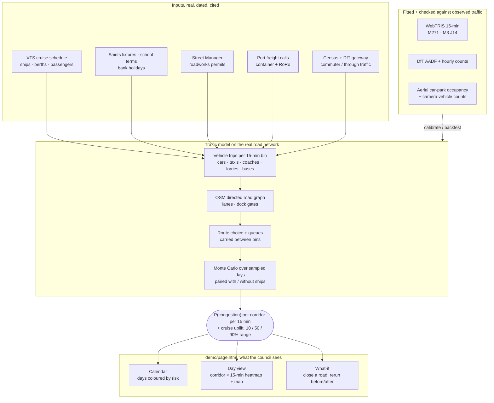

# Sotonship26: cruise-day traffic forecast for Southampton

**We help Southampton City Council's traffic officers decide where to put marshals, sign messages and roadworks holds on cruise days around the Southampton docks, using a probabilistic traffic forecast and a learned plan built on public data.**

Southampton City Council's traffic team has to decide, days ahead, which cruise turnaround days and
hours need marshals at the dock gates, a sign message or a hold on roadworks. This project turns
the port's published ship schedule and public traffic data into a probabilistic forecast for each
main road and 15 minutes. For each one it gives the chance of congestion, the extra traffic the ships
add with a likely range, and a suggested plan an officer can approve.

- **Brief:** [docs/brief.md](docs/brief.md), covering the problem, user, results, limits and
  business case.
- **Design decisions:** [docs/decisions.md](docs/decisions.md), what we chose and why.
- Built at SotonShip 2026 (Southampton City track), 16–18 Oct 2026.

## In a paragraph

Southampton City Council's traffic team must decide, for each cruise day, where to put marshals,
what to show on signs, and whether to pause roadworks near the docks. Today it's a judgement call,
and a bad guess means gridlock on the A33 and dock approaches, late buses and angry residents.
Sotonship forecasts it: for every road corridor and 15-minute slot we give the probability of
congestion and the extra traffic a ship adds, as a 10/50/90% range, built from the cruise schedule,
football fixtures, school terms, roadworks and port freight, run over the real road network and
checked against observed traffic. A learned plan (PPO) then suggests marshals and signs: on
simulated held-out days it avoids about 3 congested road-hours a day for roughly £2,500 a day of
staff time, and a no-cost ship-timing advisor saves about £7,100 a day. Every suggestion needs an
officer's approval.

## How it works



1. **Trips.** Each ship call becomes car drop-offs, park-and-cruise cars, taxis and coaches, timed
   by disembarkation and boarding. These are added to everyday traffic built from Census commuting,
   DfT counts and land use, plus port lorries.
2. **Routing.** Trips are routed every 15 minutes over the real road network. Traffic that cannot
   get through a full road queues into the next 15 minutes.
3. **Sampling.** Each date is simulated many times, once with and once without the ships, which
   gives the odds of congestion and the ships' own effect.
4. **Fitting.** The model is fitted to council and DfT counts. The cruise effect is learned from
   National Highways counts on the M271 on past cruise days, and every learned part is scored
   against the rules a planner would use.

## Results

| What | Result | Where |
| --- | --- | --- |
| Cruise effect on the M271, 179 held-out days (Jan–Jun 2026) | Error 877 vehicles a day against 1,233 for the last comparable cruise day and 1,353 for no cruise effect. 87% of days inside the 80% band. Most of the gain is the calendar; the ship data adds 2% per 15 minutes. | [docs/backtest.md](docs/backtest.md) |
| Everyday traffic, M3 J14, 355 held-out days | Ridge regression beats a five-week year-ago median by 6.6% (90% interval 0.5–12%), refitted only on counts published 105 days earlier. It does not beat that rule on the M271. | [notes/flow-forecast.md](notes/flow-forecast.md) |
| Decision policy (PPO), 7 held-out cruise dates, 140 simulated days | Avoids 3.1 congested road-hours a day (95% interval 2.2–3.9; better on all 7 dates and 96% of days), with total delay unchanged, for about £2,500 a day of marshal and sign time (95% £682–£4,451), about £830 per road-hour avoided. In money alone it is a cost, not a saving. The ship-timing advisor saves about £7,100 a day (95% £3,400–£11,100) and avoids 1.2 road-hours; a simple 85% rule doesn't help. All simulated; unit costs and the effect of marshals and signs are assumed. | [docs/ppo-results-aa8eae9.md](docs/ppo-results-aa8eae9.md), [docs/ppo-robust-aa8eae9.md](docs/ppo-robust-aa8eae9.md) |
| Checks on the model | Fits to DfT and council counts, a bus run-time check on Portswood Road, and a microsimulation (SUMO) cross-check | [docs/west-side-counts.md](docs/west-side-counts.md), [docs/queues.md](docs/queues.md), [docs/sumo-check.md](docs/sumo-check.md) |

All results come from public counts or simulation, and each write-up states its sample, dates and
limits.

## Limits, and what happens when it fails

- **Outside coverage.** A date past the published ship schedule gets an "Outside coverage" notice
  and no forecast, rather than a guess. Ships with no published passenger figure are flagged and
  given a wider range.
- **Data age.** The schedule is provisional: most calls only get clock times about six days ahead.
  WebTRIS counts are published about 105 days late, so the everyday model is refitted on older counts.
- **Known losses.** On the M271 the everyday model loses to a five-week year-ago median, and the
  ship list adds only about 2% per 15 minutes over the calendar. See [docs/backtest.md](docs/backtest.md)
  and [notes/flow-forecast.md](notes/flow-forecast.md).
- **Assumed effects.** What marshals and signs do to capacity, and the cost weights (including
  £5,000 per congested road-hour, a risk weight rather than money), are our assumptions.
- **Simulated, and labelled.** Traffic on the page is modelled, not measured; the page says which
  numbers are published, observed or modelled, with the source and collection time of each.
- **Business case and a second city:** [docs/brief.md](docs/brief.md).

## Build the forecast page

The page is one HTML file, `demo/out/demo.html`. It is never committed, because it embeds ABP's
schedule (see Data sources). The demo code needs no install beyond [uv](https://docs.astral.sh/uv/)
and Python 3.12:

```bash
UV="uv run --no-project --python 3.12 --with numpy --with scipy --with networkx --with pandas --with shapely --with pyproj"

$UV --with osmnx python demo/osm_base.py                 # once: road network from OpenStreetMap
$UV python demo/external_data.py                         # once: Census commuters and DfT counts
$UV --with scikit-learn python demo/webtris_backtest.py  # learned cruise uplift on the M271
$UV python demo/collect_schedule.py                      # each build: the current VTS schedule
$UV --with scikit-learn python demo/synthetic_demo.py --workers 8      # forecast -> demo/out/demo.html
$UV python demo/buses.py fetch && $UV python demo/agents.py            # buses and individual vehicles
$UV --with gymnasium --with stable-baselines3 --with torch \
    python demo/train_ppo.py evaluate --model models/ppo/1889084/model.zip --workers 4
$UV python demo/page_extras.py --template demo/page.html               # vehicles, buses and PPO into the page
```

- **Laptop builds.** On a laptop use fewer samples, for example `synthetic_demo.py --n 16`.
- **Full builds on Iridis.** The full build (30 samples per date, PPO training) runs on the
  University of Southampton's Iridis cluster with the scripts in `cluster/iridis/`
  (`forecast.slurm`, `agents_ppo_cpu.slurm`, `agents_ppo_gpu.slurm`), set up with
  `cluster/iridis/demo_env.sh`.
- **Observed bus lateness.** Collect it on the day with
  `uv run --no-project --python 3.12 python scripts/bustimes.py collect --minutes 480`, then run
  `scripts/bustimes.py export` before `page_extras.py`.

### Package, tests and GPU builds

The Python package (`src/sotonship26`) uses uv and PyTorch. PyTorch is installed through an extra
chosen per machine: `cpu`, `cu126`, `cu130` (NVIDIA) or `rocm` (AMD, Linux). The setup scripts
detect the right one and run a GPU check:

```bash
bash scripts/setup_env.sh                                   # Linux
powershell -ExecutionPolicy Bypass -File scripts\setup_env.ps1   # Windows
uv run --extra cpu pytest
uv run --extra cpu ruff check .
```

Plain `uv run` syncs back to no extra, so pass the extra each time or activate `.venv`. On Iridis,
copy `cluster/ssh_config.example` into `~/.ssh/config`, then run `bash scripts/setup_env.sh cu126`
on a login node and `sbatch cluster/iridis/gpu_check.slurm`.

## Repository map

| Path | What is there |
| --- | --- |
| `demo/` | The product: traffic model (`traffic_model.py`), forecast build (`synthetic_demo.py`), real inputs (`collect_schedule.py`, `external_data.py`, `freight_days.py`), the page (`page.html`, `page_extras.py`, layout variants in `ui_variants.py`, icons and sprite sheets in `assets/` built by `sprites.py`), individual vehicles and buses (`daysim.py`, `agents.py`, `buses.py`), the PPO layer (`ppo_env.py`, `ppo_gpu.py`, `train_ppo.py`, `ppo_stats.py`), and checks (`webtris_backtest.py`, `ridge_history.py`, `bus_check.py`, `queue_report.py`, `sumo_*.py`) |
| `src/sotonship26/data/` | Loaders: VTS schedule (`vts.py`) and freight (`vts_freight.py`), DfT counts (`dft.py`), WebTRIS (`observed.py`), past cruise calls (`cruise_history.py`), road network (`roads.py`), cameras (`cameras.py`), observed bus lateness (`bus_lateness.py`) |
| `src/sotonship26/` | Everyday traffic forecast (`flow_forecast.py`), cruise uplift and backtest (`uplift.py`, `uplift_model.py`, `backtest.py`, `run_backtest.py`), corridors (`corridors.py`), vehicle counting from imagery (`imagery/`, `vision/`), NTIS scoring (`ntis_score.py`) |
| `src/sotonship26/` (parked) | The first design, pedestrians and the waterway: `data/streets.py`, `data/waterway.py`, `data/tides.py`, `demand/`, `routing/`, `forecast/`, `rl/`, `train.py`, `evaluate.py`, `synthetic.py`. It is tested but not used by the product. |
| `docs/` | Brief, design decisions, the original plan and the technical write-ups |
| `notes/` | Evaluation notes, local evidence, the submission draft |
| `models/ppo/1889084/` | The trained PPO policy used on the page |
| `data/webtris/` | M271 speed and flow extracts (OGL), committed for the forecast engine |
| `tests/`, `scripts/`, `cluster/`, `configs/` | Tests, helper scripts, Iridis jobs, settings |
| `coord/` | How the team's three coding sessions coordinated through Linear |
| `Context/` | The event's rules and track briefs |

## Data sources

Every source, what it is used for, when it was collected and its licence. Raw files from sources
that may not be redistributed stay in gitignored `data/raw/` or `data/cache/`; only aggregates are
published.

| Source | Used for | Collected | Licence |
| --- | --- | --- | --- |
| [ABP Southampton VTS cruise ship schedule](https://www.southamptonvts.co.uk/live_information/shipping_movements_and_cruise_ship_schedule/cruise_ship_schedule/) (the XML feed behind the public page) | Ship calls, berths and times for the forecast window (`demo/collect_schedule.py` → `data/raw/cruise_schedule.csv`, and `src/sotonship26/data/vts.py` → `data/raw/vts/`). Each row records when it was collected. Only the next few days have clock times; TBA/AM/PM entries use the median exact times in the same feed (06:15 and 17:00). | At each build; first 16 Oct 2026 | © ABP, all rights reserved. The [terms of use](https://www.southamptonvts.co.uk/terms_of_use/) allow extracts for personal reference only, so the data is read locally, credited to ABP and not redistributed. |
| The same schedule page, [Internet Archive](https://web.archive.org/) captures of 13 Jan 2024, 25 Sep 2024, 4 Jul 2025 and 8 Dec 2025 | Past cruise calls for the M271 backtest (`demo/webtris_backtest.py`): 792 calls on 625 of 912 days, Jan 2024 to Jun 2026 | Retrieved 16 Oct 2026 | © ABP; personal reference with ABP acknowledged; not redistributed (team decision 17 Oct 2026, SOT-21) |
| Cruise lines' published ship facts (P&O Cruises, Cunard, Celebrity, MSC, AIDA, Princess, Fred. Olsen, TUI Cruises, Oceania, NCL) and, for `ship_capacity.csv`, Wikipedia and cruise line pages | Passengers per ship, aiming at two guests per cabin. Basis and URL per ship in `CAPACITY` (`demo/collect_schedule.py`) and per row in `src/sotonship26/data/ship_capacity.csv`. AIDA and MSC Preziosa publish only cabins and a maximum, so their figure is 2 × cabins. | 16–17 Oct 2026 | Facts cited to each page |
| [Wikidata](https://www.wikidata.org/) passenger capacity (P1083) | Ship capacity in the M271 backtest, matched on ship name | 16–17 Oct 2026 | CC0 |
| Southampton FC [2026/27 fixtures](https://www.southamptonfc.com/en/news/article/2026-27-fixtures-saints-start-away-to-watford) and [Sky Sports selections](https://www.southamptonfc.com/en/news/article/six-saints-fixtures-selected-for-sky-sports-coverage) | Home matches in the forecast window (`MATCHES` in `demo/synthetic_demo.py`): 17 Oct (15:00), 31 Oct (15:00), 21 Nov (12:30), Fri 27 Nov (20:00) | 16 Oct 2026 | Dates and kick-offs are facts, cited to the club; TV picks can still move them |
| [football-data.co.uk](https://www.football-data.co.uk/) results files | Past Saints home league matches for the backtest (cups missing) | 16–17 Oct 2026 | Free download; only match dates are used |
| Southampton City Council [school term dates](https://www.southampton.gov.uk/schools-learning/school-information/school-term-dates/), 2023-24 (via the [Wayback Machine](https://web.archive.org/web/20240303065857/https://www.southampton.gov.uk/schools-learning/school-information/school-term-dates/school-year-calendar-2023-24/)) to 2026-27 | Half-term and term end in the forecast; the school-holiday feature in `flow_forecast.py`. Maintained and voluntary-controlled schools; academies may differ. | 16–17 Oct 2026 | Dates cited to the council |
| GOV.UK [bank holidays](https://www.gov.uk/bank-holidays), England and Wales | `BANK_HOLIDAYS` in `uplift.py` | 16 Oct 2026 | Open Government Licence v3.0 |
| DfT Street Manager open data, [permit archive](https://department-for-transport-streetmanager.github.io/street-manager-docs/archived-notifications/) `permit/2026/08.zip` and `09.zip` | Granted daytime works with signals or a lane closure on the corridors (`PERMITS` in `demo/synthetic_demo.py`): Platform Road 19–23 Oct and 2–6 Nov, Portswood Road 19–30 Oct and 20–23 Oct, M271 29–30 Oct. Left out: overnight-only lane closures (M271, Millbrook Road West, Mountbatten Way, Redbridge Road, 4–7 Nov), a 07:00–09:00 closure on Northam Bridge (Sun 18 Oct), applications not granted by 30 Sep (Western Esplanade 19–24 Oct and 2–3 Nov, The Avenue 24 Nov, M27 overnight 22–23 Oct) and works that only encroach on the carriageway. October grants are not archived until 1 Nov, so later short-notice works are missing. | 16 Oct 2026 (events to 30 Sep 2026) | Open Government Licence v3.0 |
| OpenStreetMap via osmnx and the [Overpass API](https://overpass-api.de/) | Road network, lanes, speed limits, dock gates, land use for zones (`demo/osm_base.py`, `src/sotonship26/data/roads.py`); the SUMO cross-check network (`demo/sumo_net.py`) | 16 Oct 2026 (OSM base 21:45 UTC); SUMO network 17 Oct 2026 | ODbL 1.0 |
| ONS Census 2021 ODWP01EW, place of residence and work by MSOA ([Nomis bulk download](https://www.nomisweb.co.uk/sources/census_2021_od)); method of travel to work by distance ([census API](https://api.beta.ons.gov.uk/v1/population-types/UR/census-observations?area-type=ltla&dimensions=transport_to_workplace_12a,workplace_travel_10a)); MSOA population-weighted centroids (Open Geography Portal) | Commuters into and out of the area, their car share and gateway; residents aged 16+ and workplace counts per MSOA, which set each zone's homes and jobs (`demo/external_data.py`). Census day was 21 Mar 2021, in lockdown. | 16 Oct 2026 | Open Government Licence v3.0; contains OS data © Crown copyright and database right |
| DfT road traffic statistics: [AADF per count point](https://roadtraffic.dft.gov.uk/downloads) (2025 counts, published Jun 2026) and, via the API, AADF by direction and hourly manual counts for Southampton (LA 137) | Traffic crossing the edge of the area and lorry counts the model is fitted to (`demo/external_data.py`): traffic at each county gateway, less census commuters and visitors, is split 30% through traffic and 70% other trips to the area's zones (assumed); background traffic on counted roads (`src/sotonship26/data/dft.py`) | 16 Oct 2026 | Open Government Licence v3.0 |
| Southampton City Council / WSP, *Portswood Project Baseline Data Report*, Jan 2025 | Peak traffic counts and bus run times on Portswood Road (Tables 3-5, 3-10) that the model is fitted to | 16–17 Oct 2026 | Figures cited to the report |
| National Highways [WebTRIS](https://webtris.nationalhighways.co.uk/api/swagger/ui/index) 15-minute counts and speeds: M271 (sites 19974, 19796, 20313, 20605, 7588) and M3 J14 (20025) | Observed traffic for the everyday forecast, the cruise backtest and the lorry day pattern (`data/observed.py`, `flow_forecast.py`, `demo/webtris_backtest.py`); extracts in `data/webtris/` | 16–17 Oct 2026; counts Jan 2024 to Jun 2026 (published about 105 days late) | Open Government Licence v3.0 (contains National Highways information) |
| ABP Southampton VTS freight movement feeds (`sotextract.xml`, `sotberthed.xml`) | Container and ro-ro calls per day, scaling port lorries (`src/sotonship26/data/vts_freight.py`, `demo/freight_days.py`, [notes/vts-freight.md](notes/vts-freight.md)) | Snapshots from 17 Oct 2026 (first 08:56 UTC) | © ABP; personal reference, not redistributed |
| [Bus Open Data Service](https://data.bus-data.dft.gov.uk/timetable/download/) timetables (GTFS, South West region) | Bluestar and First X4/X5 routes and timetables run on the modelled roads (`demo/buses.py`); Unilink is not in BODS. Fallback: OpenStreetMap bus route relations. | 17 Oct 2026 | Open Government Licence v3.0 |
| [bustimes.org](https://bustimes.org) live vehicle positions, `/vehicles.json` only (its robots.txt disallows `/api/` and `/trips/`) | Observed bus lateness on the day, per line and per area (`src/sotonship26/data/bus_lateness.py`, `scripts/bustimes.py`) | 17 Oct 2026, once a minute, 12:49–15:33 | Bus Open Data Service data, Open Government Licence v3.0, via bustimes.org |
| National Highways traffic camera stills (M27 J3–J5, M3 J14) | Vehicle counts from camera stills; counts kept, no images stored (`src/sotonship26/data/cameras.py`, `vision/`, [notes/cameras.md](notes/cameras.md)) | 17–18 Oct 2026 | © Crown copyright; National Highways standard terms allow non-commercial research with credit ("Vehicle counts derived from National Highways traffic management camera images, © Crown copyright") |
| National Highways NTIS live link speeds and predictions, via mobilityflow | NTIS's own forecasts scored against its measurements, as a baseline (`src/sotonship26/ntis_score.py`, [notes/ntis-selfskill.md](notes/ntis-selfskill.md)) | Logged every 15 minutes from 17 Oct 2026 | Open Government Licence v3.0 (National Highways) |
| Getmapping 25 cm aerial photography via EDINA Digimap Aerial | Car-park occupancy at the cruise terminals (`src/sotonship26/imagery/`) | Downloaded by hand with a university login during the event | Digimap licence: analysis allowed, display not; tiles are not committed or published, credited "Getmapping via EDINA Digimap" |

**ABP attribution.** Cruise schedule and freight data, current and archived, © Associated British
Ports (Southampton VTS), used for personal reference with ABP acknowledged as its terms allow. Raw
pages, call lists and built pages are never committed.

**Public data, personal data and AI services.** Every input is public or openly licensed, with the
permission shown in the table above. The one licensed, non-open input is the Digimap aerial
photography, analysed by our own code and never published. We used no personal data: bus readings are
vehicle positions from a public feed, kept only as aggregates (raw sightings stay in gitignored
`data/raw/buses/`), and camera stills are counted and not stored. We used no non-public council
information, so none was sent to any external AI service; every council figure comes from a published
document.

**Limits of the cruise backtest.**
- Past calls are provisional plans captured on four dates, not actual berthings.
- Days no capture covers (Jul 2024, Jan to Aug 2025) are left out rather than counted as
  non-cruise days.
- The traffic sensor is one motorway site (M271 northbound), 4 to 7 km from the terminals.

## Provenance

What existed before the event, who did what, and which parts were written with AI.

**Before the event.** No code. The empty repository (a licence and a `.gitignore`, no code) was
opened at 19:03 on Fri 16 Oct 2026, and the event's own brief was added at 19:27 (`Context/`). Hacking
opened at 20:00; the first code was committed at 21:21. Open-source libraries are listed in
`pyproject.toml` and `uv.lock`.

**Who did it.** The team: Keanu Czirjak (learning and evaluation), Alex-Sebastian Ene (forecast
engine) and Edward Denton (product, data and pitch). Each worked with their own AI coding
session; the sessions coordinated through Linear (`coord/`). The humans chose the product, the
data and its permitted use, and reviewed the methods and results. No one outside the team helped.

**AI-generated.** Almost all code and writing in this repository was produced with an AI coding
assistant under the team's direction, between Fri 16 and Sun 18 Oct 2026:

- **Scaffold and first design:** `pyproject.toml` and its backend extras, `scripts/`, `cluster/`,
  `configs/`, the package skeleton and the parked pedestrian and waterway code. Written in Alex-Sebastian's session.
- **Forecast engine and page (Alex-Sebastian's sessions):**
  - The traffic model and its inputs: `demo/traffic_model.py`, `demo/synthetic_demo.py`,
    `demo/collect_schedule.py`, `demo/external_data.py`, `demo/freight_days.py`.
  - The road network: `src/sotonship26/data/roads.py`, `src/sotonship26/corridors.py`.
  - Queued traffic waiting at its bottleneck (SOT-30): `traffic_model.Queues`, its use in
    `run_day`, `demo/daysim.py` and `demo/ppo_gpu.py`, the M271 cruise probe on counted flow,
    `docs/bottleneck-queues.md`.
  - The parametric simulator for calibration (SOT-10): `src/sotonship26/forecast/simulator.py`.
  - The page: `demo/page.html`, its layout and wording.
  - Individual vehicles, buses and PPO: `demo/daysim.py`, `demo/agents.py`, `demo/buses.py`,
    `demo/ppo_env.py`, `demo/ppo_gpu.py`, `demo/train_ppo.py`, `demo/page_extras.py`.
  - Checks: `demo/webtris_backtest.py`, `demo/ridge_history.py`, `demo/bus_check.py`,
    `demo/queue_report.py`, `demo/sumo_*.py`.
  - The car-park imagery pipeline: `src/sotonship26/imagery/`.
  - The Iridis jobs, their tests and `docs/` except the brief and decisions.
  - The facts behind the inputs (fixtures, term dates, ship capacities, roadworks permits) were
    looked up and transcribed in the same sessions.
- **Learning and evaluation (Keanu's sessions):**
  - `src/sotonship26/data/observed.py`, `cruise_history.py`, `vts_freight.py`, `cameras.py`.
  - `flow_forecast.py`, `uplift.py`, `uplift_model.py`, `backtest.py`, `run_backtest.py`.
  - `ntis_score.py`, `calibrate.py` (the SOT-8 calibration harness), `vision/`,
    `scripts/plot_flow_forecast.py`, `scripts/observed_noise.py`.
  - The NTIS skill numbers are provisional, units unconfirmed, and labelled "do not quote as
    validated NTIS skill". Calibration output (`runs/calibration/best.json`) is gitignored and
    labelled with its source; the synthetic stand-in is marked `source: "synthetic"`.
  - Their tests and everything in `notes/` except `local-evidence.md`.
  - Keanu reviewed the method and the baseline corrections (`notes/ml-walkthrough.md`).
- **Product, data and documents (Edward's sessions):**
  - Loaders: `src/sotonship26/data/vts.py`, `dft.py`, `bus_lateness.py`, `scripts/bustimes.py`.
  - The page's PPO charts and observed-bus panel: `demo/ppo_stats.py`, `demo/page.html`.
  - The app UI: the app shell, themes (including Steamship), action cards, `?` pop-ups and
    live-map styling in `demo/page.html`; `demo/ui_variants.py` (the Story app with its landing
    page, plus the Focus, Officer and Wallboard layouts); `demo/sprites.py`, which animates the
    icons into the sprite sheets in `demo/assets/sprites/`.
  - Their tests.
  - `notes/local-evidence.md`, compiled from the public sources cited on each line.
  - `docs/brief.md`, `docs/decisions.md` and this README.
- **Images:** the cruise icons in `demo/assets/` (ship, life ring, anchor, wheel, seagull,
  lighthouse, captain's hat) were made with Canva's AI image generator on Sat 17 Oct 2026 and
  cut out of their white backgrounds by script. The landing page's sound is synthesised in the
  browser: gull cries, waves, a horn and "Drunken Sailor", a traditional tune in the public
  domain; no recordings are used.
- **Pitch video and submission text:**
  - `demo/video/pitch/` (Edward's session): the scene designs, the narration script, the
    live-page capture and the encode. The narration is a synthetic voice (Microsoft Edge neural
    voice `en-GB-RyanNeural`, via the `edge-tts` package); the QR code is generated locally.
  - `demo/video/` overlays and build script, `docs/pitch-playbook.md` and `SUBMISSION.md`
    (Keanu's sessions).
- **Trained models:** the PPO policy in `models/ppo/` was trained by Stable-Baselines3 on our
  simulator. The microsimulation check uses Eclipse SUMO 1.28.0 (EPL-2.0). The vehicle detector
  uses pre-trained YOLO weights (not committed).

## Licence

Code: Apache License 2.0 ([LICENSE](LICENSE)). Data keeps its own licence (see Data sources).
