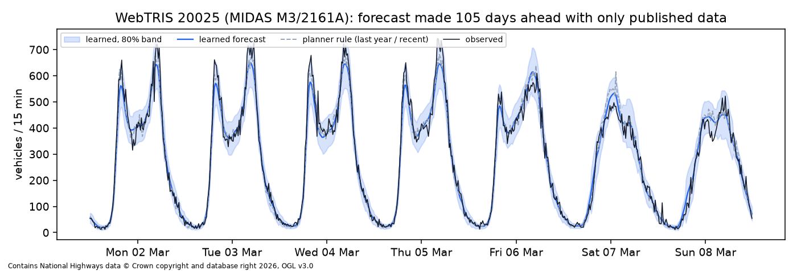

# Everyday traffic forecast on the dock approaches: learned model vs baselines

Generated Sat 17 Oct 2026 00:08 by `python -m sotonship26.flow_forecast --cutoff 2025-07-01 --lag 105`. Data: National Highways WebTRIS 15-minute counts, 2024-01-01 to 2026-06-30 (Contains National Highways data, OGL v3.0).

Each test day after 2025-07-01 is forecast using only counts published 105 days before it, because WebTRIS lags about 3.5 months. Scores cover 05:00-22:00. Ridge is compared with each baseline on the days both can forecast (sensor gaps differ). `skill` = 1 - MAE(ridge) / MAE(baseline): above 0 means the learned model wins. `coverage80` should be near 0.80.

| site_id | versus | model | n_test_days | mae_veh_per_15min | skill_vs_baseline | wape_pct | coverage80 | width80_veh |
|---|---|---|---|---|---|---|---|---|
| 19974 | last_year | last_year | 17 | 31.56 | nan | 9.20 | 0.83 | 115.84 |
| 19974 | last_year | ridge | 17 | 31.76 | -0.01 | 9.25 | 0.78 | 96.60 |
| 19974 | recent_median | recent_median | 178 | 46.46 | nan | 13.06 | 0.72 | 120.85 |
| 19974 | recent_median | ridge | 178 | 38.64 | 0.17 | 10.86 | 0.75 | 108.24 |
| 19974 | planner_rule | planner_rule | 178 | 45.24 | nan | 12.72 | 0.74 | 121.95 |
| 19974 | planner_rule | ridge | 178 | 38.64 | 0.15 | 10.86 | 0.75 | 108.24 |
| 20313 | planner_rule | planner_rule | 29 | 20.38 | nan | 21.34 | 0.84 | 68.57 |
| 20313 | planner_rule | ridge | 29 | 27.14 | -0.33 | 28.42 | 0.59 | 55.87 |
| 20605 | planner_rule | planner_rule | 26 | 19.17 | nan | 22.61 | 0.81 | 55.48 |
| 20605 | planner_rule | ridge | 26 | 29.71 | -0.55 | 35.05 | 0.47 | 51.03 |
| 20025 | last_year | last_year | 351 | 43.48 | nan | 11.72 | 0.80 | 130.47 |
| 20025 | last_year | ridge | 351 | 36.17 | 0.17 | 9.75 | 0.79 | 109.91 |
| 20025 | recent_median | recent_median | 356 | 48.44 | nan | 13.08 | 0.77 | 132.86 |
| 20025 | recent_median | ridge | 356 | 36.09 | 0.25 | 9.74 | 0.79 | 109.92 |
| 20025 | planner_rule | planner_rule | 356 | 43.54 | nan | 11.76 | 0.81 | 131.43 |
| 20025 | planner_rule | ridge | 356 | 36.09 | 0.17 | 9.74 | 0.79 | 109.92 |

Reading it: sites with a long, continuous record (20025 M3 J14, 19974 M271 NB) are the trustworthy results. 20313/20605 have under 30 comparable test days and patchy sensor data, so their scores are noise. 7588 and 19796 have no test days after the cutoff.

Cruise days are not removed (no historic cruise list yet, see SOT-21), so these forecasts are 'typical traffic including the average cruise effect'. Forward forecasts for any date range: `--forecast FROM TO` writes runs/flow_forecast/<site>.csv (date, tod_bin, flow_veh, lo80, hi80).
